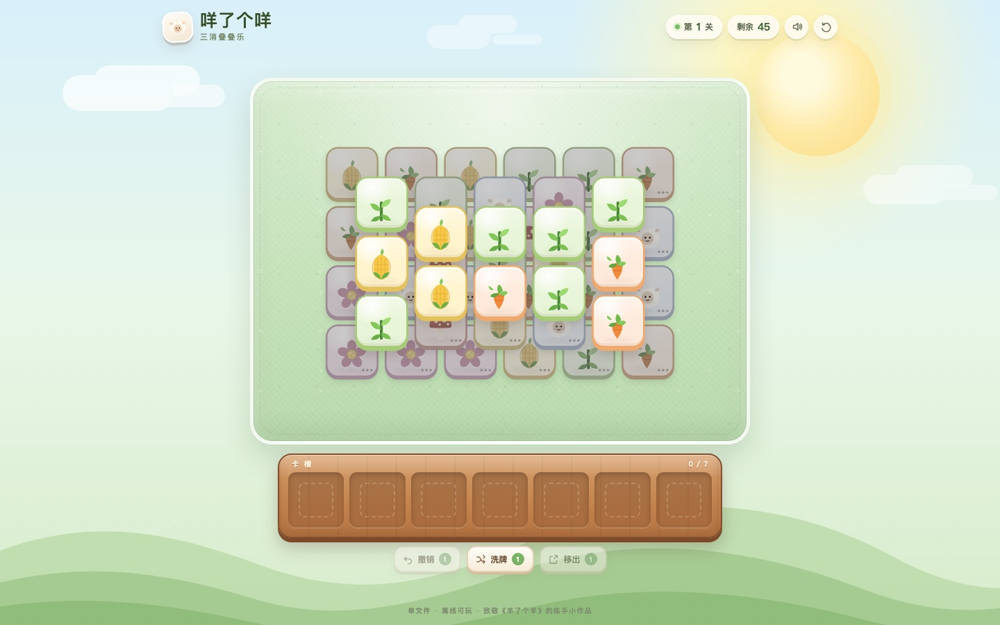

# 咩了个咩

一个「羊了个羊」风格的三消叠叠乐小游戏，单文件、零依赖、离线可玩。



## 运行

直接用浏览器打开 `index.html` 即可。

也可以起一个本地静态服务器（推荐，地址更稳定）：

```bash
cd sheep-game
python3 -m http.server 8765
# 浏览器访问 http://127.0.0.1:8765/
```

## 玩法

- 点击没有被上层压住的牌，把它收进底部的 7 格卡槽。
- 卡槽里凑齐 3 张相同的牌会自动消除。
- 清空所有牌即通关；卡槽满 7 张且没有三消则失败。
- 第一关的牌堆较薄，第二关层数更多、牌数更多。

三张道具牌每关各 1 次：

| 道具 | 作用 |
| --- | --- |
| 撤销 | 把上一张收进卡槽的牌退回牌堆 |
| 洗牌 | 重新打乱牌堆中剩余牌的花色 |
| 移出 | 把卡槽最前面的最多 3 张牌移到暂存区，腾出卡槽 |

暂存区的牌可以再点回卡槽；暂存区不占 7 格卡槽，但里面的牌也必须消掉才能通关。

## 实现说明

- 所有 HTML、CSS、JavaScript 和 SVG 图标都在 `index.html` 一个文件里，不请求 CDN、图片或字体。
- 牌堆由多层坐标组成；一张牌只要被更高层且矩形相交的牌覆盖，就不可点击。
- 发牌时先生成一条合法的「逐张剥开」顺序，再按顺序每 3 张一组分配花色，因此每一局都至少存在一条可通关路径。
- 第一关开局可见的牌会按三张一组发牌，让开局更容易上手。
- 支持桌面和移动端，尊重 `prefers-reduced-motion`；音效由 Web Audio 实时合成，可静音。

## 兼容性

已在 Chrome 的桌面视口和 390 × 844 移动视口中验证，无横向溢出；建议使用近期版本的 Chrome、Safari 或 Edge。

---

本作品是致敬《羊了个羊》玩法的练手项目，与原作者无关。
